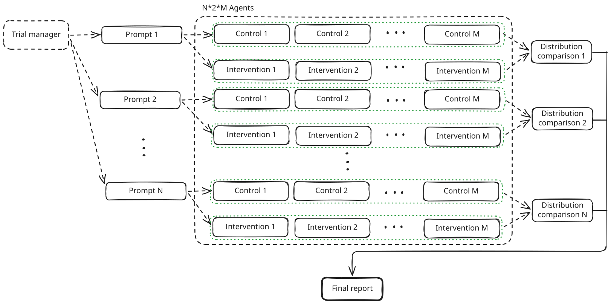

# Randomized Control Trials for agentic rules

(AI:0 under https://www.namtao.com/0rwx/)

Use the idea of RCT to run tests on a new rule added to agents, to test its
validity. I propose this would effectively be equivalent to running unit tests
for context elements (such as rules).

This is intended as an initial implementation of the concept, it still has
some issues, and encourage changes.

After the skill finishes running I encourage the user to ask for a report.



## Algorithm

Given a new rule was created in the change set to be evaluated (for example,
in the git staged changes).

1. Start a new trial manager model (which is at least as capable as the most
capable agent that is required to effectively execute the rule)
2. Find promps that produce changes judged to involve the rule, these prompts
should be generated from (ordered by priority):  
    a. reviewing current changes  
    b. git blame (repeating previously done changes)  
    c. Invent changes to be made
3. Create two worktrees, one with the rule (intervention worktree) and one
without the rule (control worktree)
4. Having a set of N prompts, run 2M trials for each prompt, running each
prompt M times in the intervention worktree, and M times in the control
worktree.  
    a. Here each agent must be in a read only mode and the context and memory
    should be clean, run the agent on Sonnet low by default.  
    b. The agent should return either a failure state (discontinued) or a set
    of changes to perform the
requested change.
5. Once all runs have finished, for each of the prompts, valuate if the rule
produced a change on the outputs by comparing the control group to the
intervetion group, and produce a report on the distribution of change. 
6. Once all prompts have a report on the distrubution of change, produce a
final report, which should inform the user of the effect. The effect will
either be:  
    a. "no change": The rule has no identifiable change  
    b. "effective change": The rule produces a change and it
    is believed to be the expected one.  
    c. "ineffective change": The rule produces a change and it is believed to
    be counter productive to the original expected change (as inferred by the
    tester model based on the user's instructions).

## Proposed concrete implementation

An implementation of the algorithm was created using Claude Opus 5.5 on high,
(thus is AI:W under https://www.namtao.com/0rwx/), and has quite a few issues.
First, there is an issue on the use of an invented numerical rating system,
I think this idea is wrong due to the statistically problematic data it is
feeding on, and the stockastic nature of the creation of the number itself.
Also it think the implementation has trouble creating the final report, and
the use must ask for data themselves. Finally, the model provided is
basically hardcoded to be Anthropic.

## License

```
MIT License

Copyright (c) 2026 EmmanuelMess

Permission is hereby granted, free of charge, to any person obtaining a copy
of this software and associated documentation files (the "Software"), to deal
in the Software without restriction, including without limitation the rights
to use, copy, modify, merge, publish, distribute, sublicense, and/or sell
copies of the Software, and to permit persons to whom the Software is
furnished to do so, subject to the following conditions:

The above copyright notice and this permission notice shall be included in all
copies or substantial portions of the Software.

THE SOFTWARE IS PROVIDED "AS IS", WITHOUT WARRANTY OF ANY KIND, EXPRESS OR
IMPLIED, INCLUDING BUT NOT LIMITED TO THE WARRANTIES OF MERCHANTABILITY,
FITNESS FOR A PARTICULAR PURPOSE AND NONINFRINGEMENT. IN NO EVENT SHALL THE
AUTHORS OR COPYRIGHT HOLDERS BE LIABLE FOR ANY CLAIM, DAMAGES OR OTHER
LIABILITY, WHETHER IN AN ACTION OF CONTRACT, TORT OR OTHERWISE, ARISING FROM,
OUT OF OR IN CONNECTION WITH THE SOFTWARE OR THE USE OR OTHER DEALINGS IN THE
SOFTWARE.
```
 
